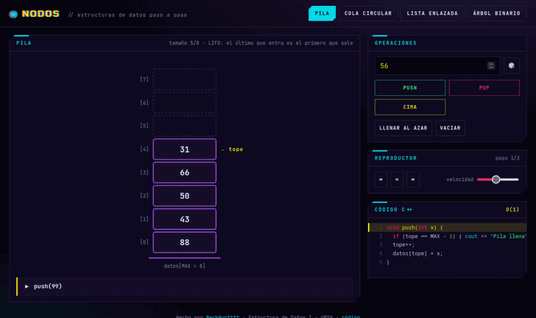
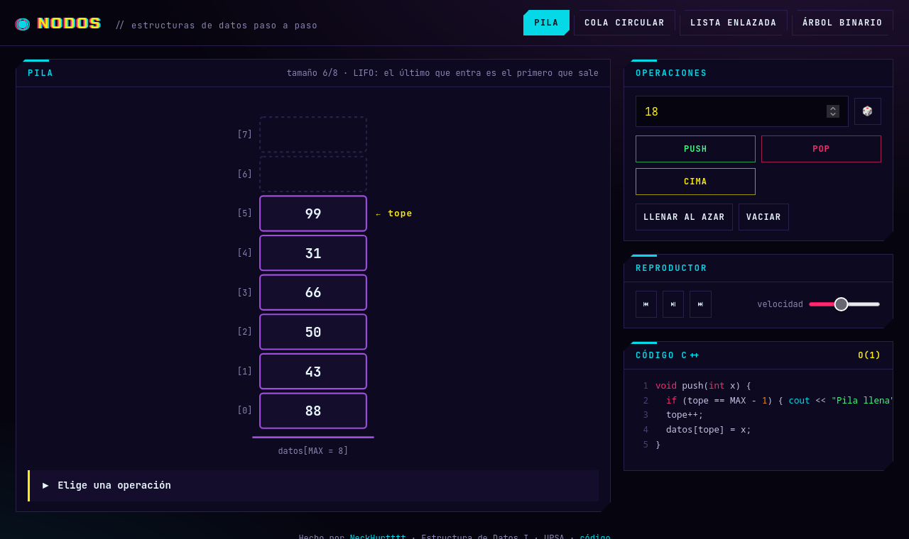
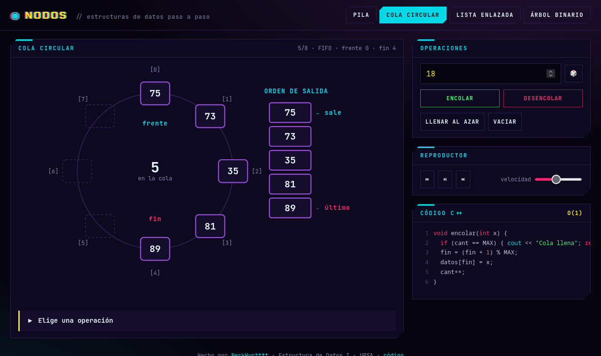
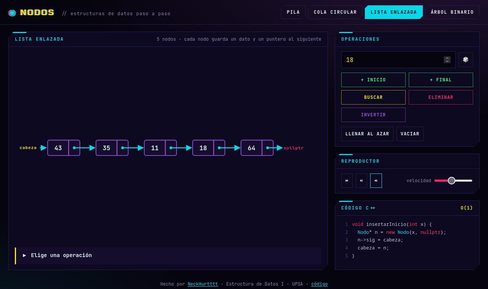
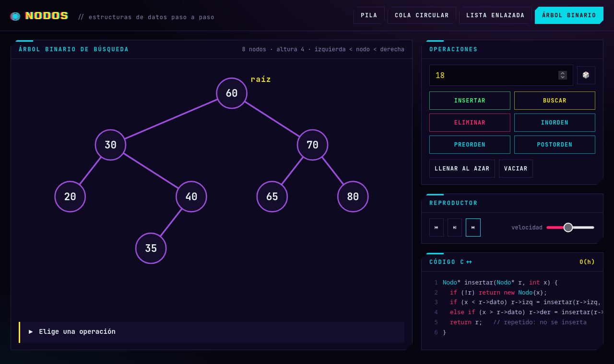

<div align="center">



### Mira lo que pasa dentro de una estructura de datos, línea por línea.

<a href="https://neckhurtttt.github.io/nodos/"></a>
<a href="#english"></a>




<sub>Push en la pila → eliminar un nodo con <b>dos hijos</b> en el árbol → buscar en la lista enlazada</sub>

</div>

## ◉ Qué es

**NODOS** anima las estructuras que se ven en **Estructura de Datos I** (UPSA). Cada operación se reproduce paso a paso
y, al lado, se ilumina la línea del **código C++** que se está ejecutando, igual que en la pizarra pero sin borrar.

| Estructura | Operaciones | Lo que se ve |
|---|---|---|
| 🟦 **Pila** | push · pop · cima | Arreglo de 8, índice `tope`, pila llena y vacía |
| 🔄 **Cola circular** | encolar · desencolar | Anillo con `frente` y `fin` que **dan la vuelta**, más el orden de salida |
| 🔗 **Lista enlazada** | insertar al inicio y al final · buscar · eliminar · invertir | Nodos con puntero `sig`, el puntero `p` recorriendo y el nodo nuevo antes de enlazarse |
| 🌳 **Árbol binario de búsqueda** | insertar · buscar · eliminar · inorden · preorden · postorden | Camino de comparaciones, los **3 casos de eliminar** (hoja, 1 hijo, 2 hijos con sucesor) y la salida de cada recorrido |

Cada operación muestra su complejidad (`O(1)`, `O(n)`, `O(h)`).

<table>
<tr>
<td width="50%"></td>
<td width="50%"></td>
</tr>
<tr>
<td width="50%"></td>
<td width="50%"></td>
</tr>
</table>

## ⌨️ Controles

- Escribe un valor y elige la operación (o **Enter** para la primera).
- **⏯** reproduce, **⏮ ⏭** van paso a paso. Con el teclado: **← → espacio**.
- **Llenar al azar** carga datos de ejemplo y **Vaciar** reinicia.
- Se puede abrir directo en una estructura: `#stack`, `#queue`, `#list`, `#bst`.

## ▶️ Usar

**En línea:** https://neckhurtttt.github.io/nodos/

**En tu compu** (HTML, CSS y JavaScript sin compilar, sin dependencias):

```sh
python3 -m http.server 8000   # http://localhost:8000
npm test                      # 7 pruebas de la lógica (Node 20+)
```

## 🗂️ Estructura

- `js/structures.js`: la lógica pura. Cada operación devuelve la lista de **pasos** (foto del estado, nodos resaltados, línea de C++ y mensaje). Las pruebas revisan el resultado final.
- `js/app.js`: dibujo en SVG, reproductor y código coloreado.
- `css/app.css`: estilo neón. `tests/`: pruebas con `node --test`.

El código C++ que se muestra es el mismo estilo de las prácticas de la materia
(ver [ESTRUCTURA-DE-DATOS-1](https://github.com/NeckHurtttt/ESTRUCTURA-DE-DATOS-1)).

<a id="english"></a>
## 🌎 English

**NODOS** is an animated data-structures visualizer: **stack**, **circular queue**, **singly linked list** and
**binary search tree** (insert, search, delete with all 3 cases, in/pre/post-order traversals). Every operation plays
step by step while the matching **C++ line** lights up, with its Big-O complexity. Pure HTML/CSS/JS, no dependencies,
[try it online](https://neckhurtttt.github.io/nodos/).

<div align="center">

**Hecho por [NeckHurtttt](https://github.com/NeckHurtttt)** · Estructura de Datos I · UPSA · Santa Cruz, Bolivia 🇧🇴

<sub>push · pop · enqueue · repeat</sub>

</div>
